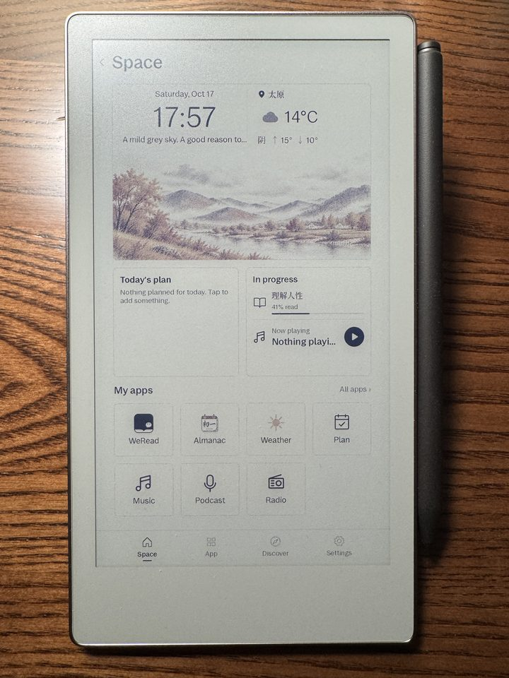
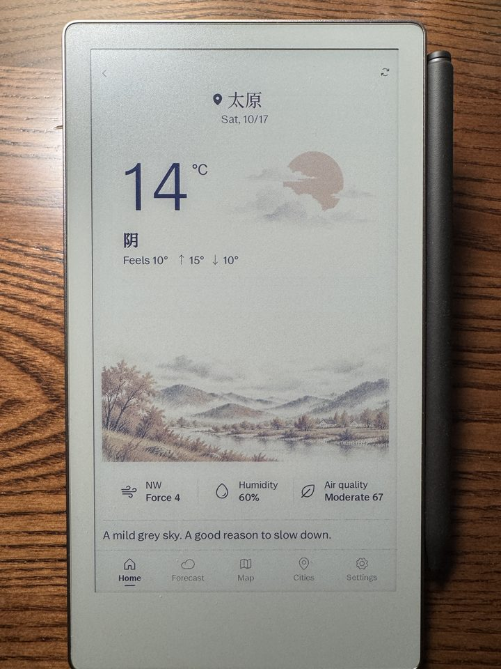
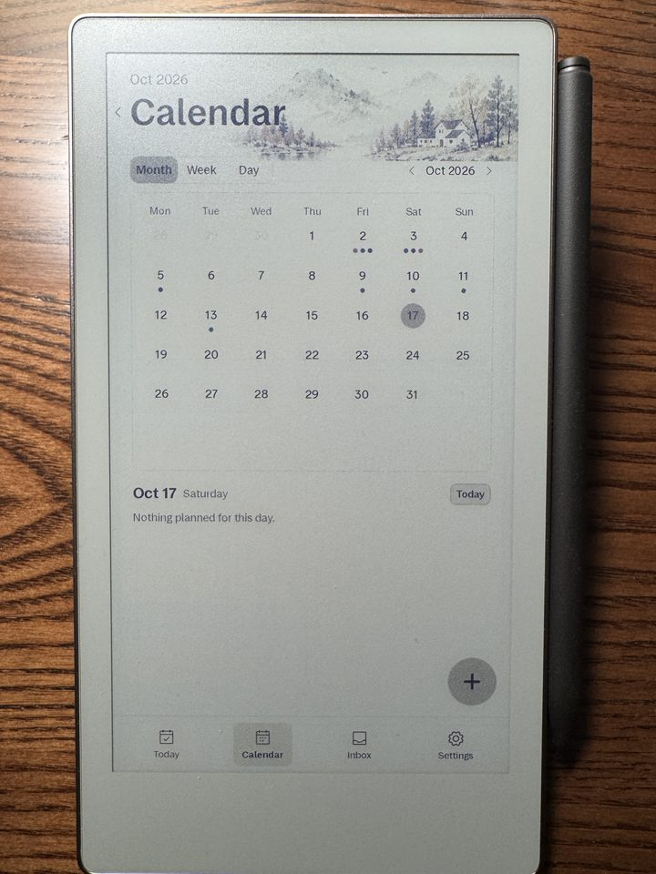
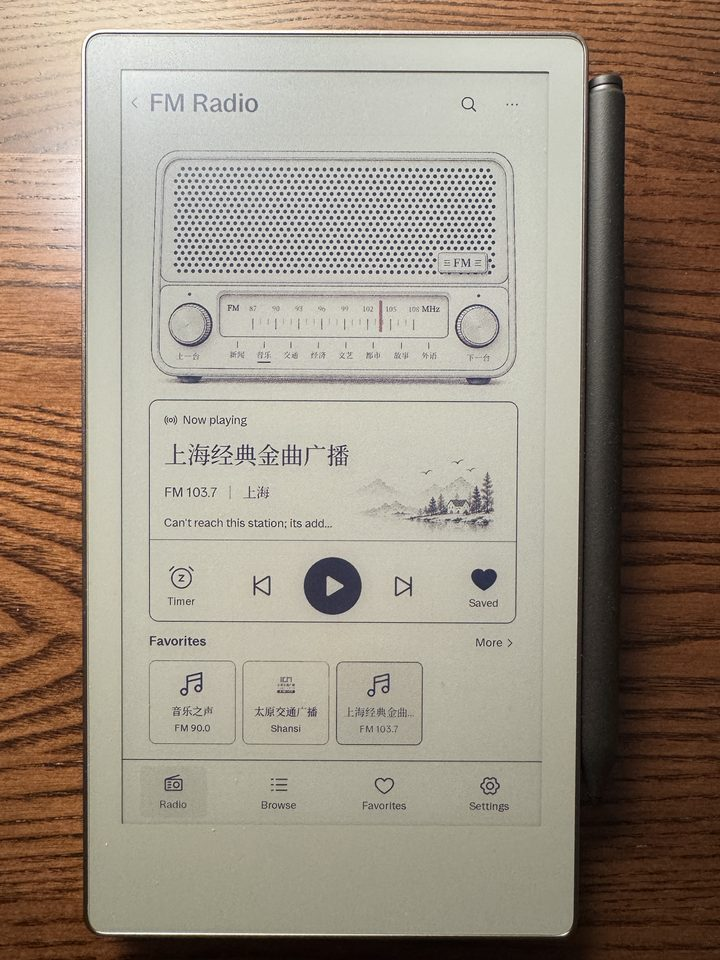

# reMarkable Space

[中文](README.md) · English

Space is a home screen for the reMarkable: cards on the front page show today's plan, the weather
and what is playing, apps are installed from a built-in catalog with one tap and removed just as easily,
and nothing in the system files is modified.

## Screenshots

| Home | Weather | Planner |
|---|---|---|
|  |  |  |

| Music | Podcasts | Radio |
|---|---|---|
|  |  |  |

## Download and install

Use the **Space Assistant**: connect the reMarkable to your computer with a USB cable and the assistant
installs Space together with the base layer it needs in one go.

| Assistant | Download |
|---|---|
| Mac | [space-assistant-mac.zip](https://github.com/boangs/remarkable-space/releases/latest/download/space-assistant-mac.zip) |
| Windows | [space-assistant-windows.exe](https://github.com/boangs/remarkable-space/releases/latest/download/space-assistant-windows.exe) |

Checksums are in `SHA256SUMS` on the [latest release](https://github.com/boangs/remarkable-space/releases/latest).

The assistant is available in Chinese and English (English UI from v1.0.8; it follows your system language and can be switched in its settings).
It needs the device's SSH password, which is shown on the device under Settings → Help → Copyrights and licenses, at the very bottom.

During installation the assistant downloads a bundle of about 140 MB. On an English system it downloads from GitHub
by default; the source can be changed under Settings → Download source. If one source fails the other is tried
automatically, and every file in the bundle is checked against its sha256 before anything is installed.

Supported devices: reMarkable 2, Paper Pro and Paper Pro Move. On a Mac, if the first launch says the developer
cannot be verified, allow it under System Settings → Privacy & Security → Open Anyway.

The base layer also adds Simplified Chinese as a system language option and a Chinese input method. Your current
language setting is not changed.

## Space disappeared after a reMarkable system update? Wait 2 minutes

On the first boot after an update you will see the **stock interface without Space**. This is normal and nothing is
lost: Space is re-adjusting itself to the new system in the background.

- **Wait 1 to 2 minutes and do not touch anything.**
- When it is done, **the screen flashes once and the interface restarts**, and Space is back.
- Do not reboot the device, reinstall Space or reflash during this time. Interrupting it can leave the device unable to boot.

This only happens on the first boot after an update; later boots are normal.

**Still stock after 5 minutes, or Space is back but all its apps are gone:** connect the assistant and reinstall Space.
(Installs made before v1.0.6 can lose their apps after a system update; once you have installed with v1.0.6 or later,
future updates recover automatically.)

**Device stuck at boot or rebooting in a loop:** connect it over USB, open the assistant, expand "Device won't boot" on the
connect page, enter the SSH password and click "Emergency repair", then let the device reboot. The device then boots in its
stock state with your notes untouched; reinstall Space with the assistant afterwards.

## Uninstalling

The assistant has an Uninstall button that removes Space and its base layer and restores the stock boot configuration.
Notes are never touched. Individual apps can also be removed one by one from the catalog on the device.

## Repository layout

The rest of this file is for developers. Space provides the home-screen widgets, the app registry, portable installs and
background services for apps. It started as part of [rmkit-cn](https://github.com/boangs/rmkit); since 2026-10-20 the base layer lives here too (`base/`) and the rmkit repository is no longer updated.

| Here | Was in rmkit-cn | What it is |
|---|---|---|
| `base/` | the whole repository | Base layer: injection chain, Chinese localisation, IME backend, post-upgrade recovery scripts; see [base/README.md](base/README.md) |
| `shell/` | `space/shell/` | The shell `Space.qml`: tabs, widget mounting, app creation and teardown, the `space` API given to apps |
| `kit/` | `space/kit/` | Shared QML components (`SRow` / `STile` / `SButton` …) and icons |
| `apps/` | `space/apps/` | **Built-in** apps, deployed by the installer. Only system entry points (settings-like); third-party apps are installed from the catalog and live in another repository |
| `server/` | `upload-server-go/internal/space/` | Go backend: registry, installs, background services, recently read, weather map rendering |
| `data/geo.json` | deployed with the backend | Vector base map for the weather app (Natural Earth, public domain, simplified) |

## Design rules

- **The shell knows no specific app.** Apps describe themselves in `manifest.json`; the shell only reads the registry.
- **Apps cannot see each other.** They talk only through the `space` API the shell provides.
- **E-ink first.** Large light areas get dithered to grey, so backgrounds are pure white and color is used only on small solid elements.
- **Cache-busting tokens.** The QML engine caches compiled results and bitmaps by URL. In development mode the shell appends
  `?t=<rev>` to `file://` URLs (`rev` = latest modification time of the app directory), so unchanged files hit the cache and
  changed ones are reloaded. Apps must build resource paths through `space.bust(url)`, otherwise replaced assets will not show.
- **Relative imports carry no token.** Changing `.js` or child QML files requires restarting xochitl, so things that are tuned
  often (color tables, illustration lists) belong in `main.qml` or in external JSON read via XHR.

## Manifest fields

```jsonc
{
  "id": "weather",              // lowercase alphanumerics, unique
  "name": "天气",
  "name_en": "Weather",
  "entry": "main.qml",          // entry point; without it, launch is used
  "widget": "widget.qml",       // optional home-screen widget
  "widget_size": "hero|half",
  "widget_slot": "plan",        // optional fixed position on the home screen
  "arch": ["aarch64", "armv7"], // empty = all
  "service": { "exec": "...", "port": 9100, "keepalive": true }
}
```

## License

[GNU GPL v3.0](LICENSE). Releases up to and including v1.0.10 were published under Apache-2.0 and remain available under it. Third-party code is listed in [base/NOTICE.md](base/NOTICE.md).
